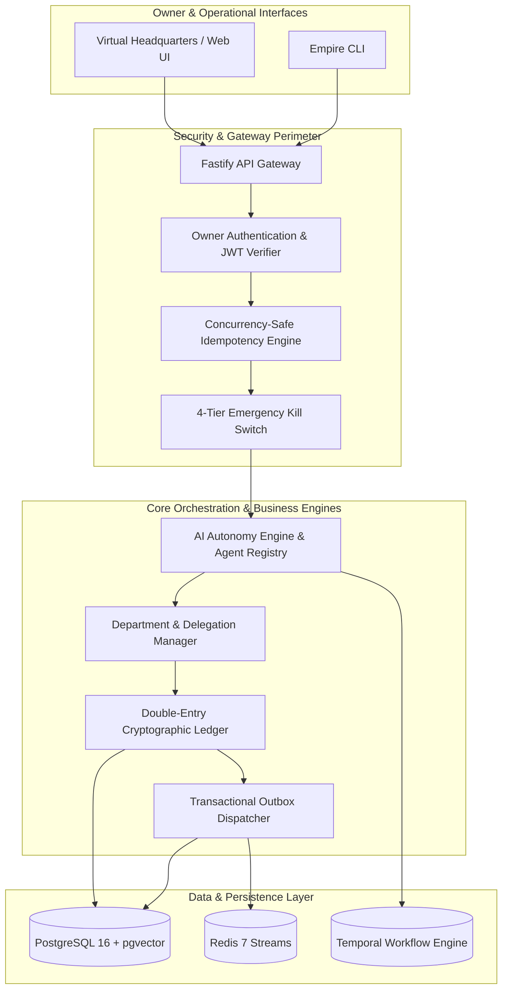

# VIRTUAL MENDEZ EMPIRE — LIVING ARCHITECTURE DOCUMENT
**System Codename:** VME-OS  
**Owner:** Stephen / Evren Mendez  
**Chief Architect:** Chief Architect & Technical Director  
**Primary Executor:** Antigravity  
**Status:** Living Engineering Baseline  

---

## 1. System Vision & Core Principles

The Virtual Mendez Empire (VME) is a fully autonomous, AI-operated corporate operating system designed to conduct corporate business, opportunity acquisition, research, financial intelligence, and operational execution with minimal day-to-day Owner intervention while strictly preserving Owner authority.

### Core Axioms
1. **Owner-Independent Operations, Owner-Controlled Authority:** Routine tasks, research, customer acquisition, and internal workflows execute autonomously. Consequential actions (capital deployment, live trading, binding contracts, public statements) require explicit Owner authorization gates.
2. **Double-Entry Financial Immutability:** Financial journals and ledgers are append-only, mathematically balanced ($\sum \text{Debits} == \sum \text{Credits}$), and cryptographically chained. Direct mutations (`UPDATE`/`DELETE`) are barred at the database engine level.
3. **Concurrency-Safe Idempotency:** Every external and internal mutation is guarded by a two-phase idempotency protocol with cryptographic payload verification.
4. **Hardened Multi-Tenant & Multi-Department Isolation:** Every process, agent, and query operates within verified tenant and department boundaries enforced via PostgreSQL Row-Level Security (RLS) and hardened `SECURITY DEFINER` functions with pinned search paths.
5. **Multi-Tier Circuit Breaker:** Any anomaly or emergency signal halts operations within <1ms locally and synchronizes across distributed nodes without single points of failure.

---

## 2. Organizational Hierarchy & Departments

VME establishes nine foundational departments:

1. **Executive Office:** Strategic objective decomposition, company-wide governance, board reports, Owner alignment.
2. **Financial Intelligence:** Central treasury, double-entry accounting, budget allocation, risk management, FX & Crypto research/paper trading divisions.
3. **Technology & Engineering:** Software engineering, architecture, code reviews, automated CI/CD, agent tooling.
4. **Business Development:** Enterprise partnership sourcing, B2B deal discovery, subsidiary incubation.
5. **Marketing & Growth:** Audience acquisition, content distribution, brand intelligence.
6. **Operations & Administration:** Workflow coordination, compliance auditing, operational monitoring.
7. **Opportunity Acquisition:** Dual-track acquisition engine:
   - *Track A (Owner Opportunities):* Remote engineering, Web3, AI contracts, job leads, automated outreach drafting.
   - *Track B (Empire Opportunities):* Bounties, commercial client leads, grants, startup consulting.
8. **Research & Intelligence:** Competitive analysis, market forecasting, sentiment tracking, tokenomics.
9. **Security & Governance:** Cryptographic credential vault, RBAC/ABAC enforcement, multi-tier kill switches, audit logs.

---

## 3. Technology Stack

- **Monorepo Architecture:** TypeScript with `pnpm` workspaces.
- **Runtime:** Node.js v24 LTS.
- **API Gateway:** Fastify with strict schema validation (Zod / TypeBox).
- **Primary Database:** PostgreSQL 16 with `pgvector` extension for vector embeddings & memory.
- **Event Streaming & Cache:** Redis 7 (Redis Streams for persistent consumer groups; in-memory cache).
- **Workflow Orchestration:** Temporal Server for long-running, fault-tolerant business workflows.
- **Desktop & Browser Automation:** Playwright with native Chrome/Edge integration, visual screenshots, and OS process isolation.
- **AI Model Gateway:** Pluggable adapter interface supporting Mock LLM (Phase 1 testing), Anthropic, OpenAI, and Google Gemini.

---

## 4. Key Architectural Mechanisms

---

## 5. Architectural Guarantees

1. **Commit-Ordered Cryptographic Ledger:** Entries hash previous row entries and are serialized under transactional locks to prevent out-of-order sequence holes.
2. **Dual-Write Consistency:** All domain mutations write to an Outbox table in the same ACID transaction as the business entity, then dispatch asynchronously to Redis Streams.
3. **Fail-Closed Execution:** Missing permissions or unverified credentials result in immediate rejection, not permissive fallbacks.

