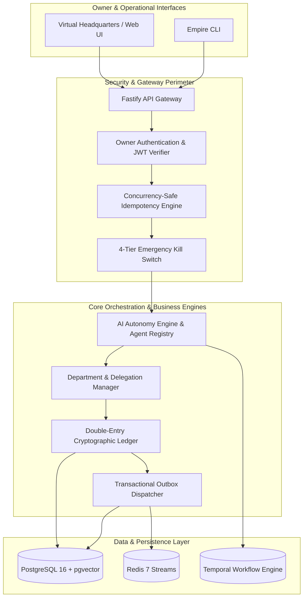

# VIRTUAL MENDEZ EMPIRE — LIVING ARCHITECTURE DOCUMENT
**System Codename:** VME-OS  
**Owner:** Stephen / Evren Mendez  
**Chief Architect:** Chief Architect & Technical Director  
**Primary Executor:** Antigravity  
**Status:** Living Engineering Baseline  

---

## 1. System Vision & Core Principles

The Virtual Mendez Empire (VME) is a fully autonomous, AI-operated corporate operating system designed to conduct corporate business, opportunity acquisition, research, financial intelligence, and operational execution with minimal day-to-day Owner intervention while strictly preserving Owner authority.

### Core Axioms
1. **Owner-Independent Operations, Owner-Controlled Authority:** Routine tasks, research, customer acquisition, and internal workflows execute autonomously. Consequential actions (capital deployment, live trading, binding contracts, public statements) require explicit Owner authorization gates.
2. **Double-Entry Financial Immutability:** Financial journals and ledgers are append-only, mathematically balanced ($\sum \text{Debits} == \sum \text{Credits}$), and cryptographically chained. Direct mutations (`UPDATE`/`DELETE`) are barred at the database engine level.
3. **Concurrency-Safe Idempotency:** Every external and internal mutation is guarded by a two-phase idempotency protocol with cryptographic payload verification.
4. **Hardened Multi-Tenant & Multi-Department Isolation:** Every process, agent, and query operates within verified tenant and department boundaries enforced via PostgreSQL Row-Level Security (RLS) and hardened `SECURITY DEFINER` functions with pinned search paths.
5. **Multi-Tier Circuit Breaker:** Any anomaly or emergency signal halts operations within <1ms locally and synchronizes across distributed nodes without single points of failure.

---

## 2. Organizational Hierarchy & Departments

VME establishes nine foundational departments staffed by 30 canonical AI employees:

1. **Executive Office (2 agents):** Strategic objective decomposition, company-wide governance, board reports, Owner alignment.
   - `EXEC-CEO`: CEO & Autonomous Director (Executive)
   - `EXEC-COO`: Chief Operating Officer (Executive)
2. **Financial Intelligence (4 agents):** Central treasury, immutable double-entry accounting, budget allocation, risk management, FX & Crypto research/paper trading divisions.
   - `FIN-CFO`: Chief Financial Director (Director)
   - `FIN-ACC`: Lead Treasury & Ledger Accountant (Specialist)
   - `FIN-FXA`: Foreign Exchange & Macro Paper Trading Analyst (Specialist)
   - `FIN-CRY`: Crypto & DeFi Risk Analyst (Specialist)
3. **Technology & Engineering (5 agents):** Software engineering, architecture, code reviews, automated CI/CD, agent tooling and platform reliability.
   - `TECH-CTO`: Chief Technology Director (Director)
   - `TECH-ARCH`: Lead Software Architect (Specialist)
   - `TECH-FSE`: Senior Full Stack Engineer (Specialist)
   - `TECH-DEVOPS`: DevOps & Platform Reliability Engineer (Specialist)
   - `TECH-QA`: QA & Systems Verification Specialist (Specialist)
4. **Business Development (3 agents):** Enterprise partnership sourcing, B2B deal discovery, commercial proposals, subsidiary incubation.
   - `BIZ-DIR`: Director of Business Development (Director)
   - `BIZ-PART`: Strategic Partnership Sourcing Specialist (Specialist)
   - `BIZ-PROP`: B2B Deal Structuring & Proposal Specialist (Specialist)
5. **Marketing & Growth (3 agents):** Audience acquisition, content distribution, social channels, brand intelligence.
   - `MKT-DIR`: Director of Marketing & Growth (Director)
   - `MKT-CONT`: Content Strategist & Copywriter (Specialist)
   - `MKT-SOC`: Social Media & Omnichannel Distribution Specialist (Specialist)
6. **Operations & Administration (3 agents):** Workflow coordination, background cron automations, compliance auditing, operational monitoring.
   - `OPS-DIR`: Director of Operations & Administration (Director)
   - `OPS-COORD`: Workflow Orchestration & Scheduling Coordinator (Specialist)
   - `OPS-COMP`: Compliance & Operational Process Auditor (Specialist)
7. **Opportunity Acquisition (4 agents):** Dual-track acquisition engine:
   - *Track A (Owner Opportunities):* Remote engineering, Web3, AI contracts, job leads, automated outreach drafting.
   - *Track B (Empire Opportunities):* Bounties, commercial client leads, grants, startup consulting.
   - `OPP-DIR`: Director of Opportunity Acquisition (Director)
   - `OPP-SCOUT`: Owner Career & Job Scout Specialist (Specialist)
   - `OPP-OUTR`: Owner Outreach & Application Preparer (Specialist)
   - `OPP-LEAD`: Enterprise Lead Generation Specialist (Specialist)
8. **Research & Intelligence (3 agents):** Deep market analysis, macro forecasting, competitive benchmarking, tokenomics.
   - `RES-DIR`: Director of Research & Intelligence (Director)
   - `RES-FORE`: Macroeconomic & Market Trend Forecaster (Specialist)
   - `RES-COMP`: Competitive Intelligence & Tokenomics Analyst (Specialist)
9. **Security & Governance (3 agents):** Cryptographic credential vault, RBAC/ABAC enforcement, multi-tier kill switches, audit logs.
   - `SEC-CISO`: Chief Information Security Officer (Director)
   - `SEC-IAM`: Identity, Access & Vault Governance Sentinel (Specialist)
   - `SEC-AUD`: Security Audit Trail & Incident Sentinel (Specialist)

### 2.1 Corporate Authority & Governance Perimeter
- **Owner Authority:** Strategic directives, capital allocation approval, consequential action authorization, governance overrides, emergency shutdown and recovery authorization.
- **Executive Authority Subordination:** CEO and executive authority remain strictly subordinate to Owner authority. Strategic coordination does not grant permission to authorize capital transfers, live trading, binding contract acceptance, or governance overrides.
- **Department Director Authority:** Department task allocation, specialist supervision, department reporting, authorized resource requests within approved treasury limits.
- **Specialist Authority:** Execution within assigned responsibilities, internal communication, progress reporting.
- **Critical Invariant:** No agent can grant itself additional permissions. Live financial trades, capital transfers, external emails, and contracts strictly require Owner authorization.

### 2.2 Separation of Immutable Identity from Mutable Configuration
- **Permanent Immutable Identity (`AgentIdentity`):** Immutable UUID (`id`), permanent uppercase code (`agentCode`, e.g. `EXEC-CEO`), founding department ID (`departmentId`), and creation timestamp (`createdAt`). Identity anchors remain permanent across promotions, role changes, and reporting tree updates.
- **Versioned Mutable Configuration (`AgentConfiguration`):** Versioned lifecycle state containing display name, job title, organizational level, reporting supervisor, assigned responsibilities, required capabilities, permission profile, operational status, model configuration, and semantic version (`configVersion`).

### 2.3 Treasury Controls & Indicative Planning Allocations
- **Department Budgets as Planning Allocations:** Monthly department budgets (`budgetMonthlyAllocationUsd`) are indicative planning ceilings, NOT automatic spending permissions.
- **Treasury Controls (`TreasurySpendingControl`):** Actual expenditures are governed by separate treasury controls enforcing single transaction limits, authorized signer level verification, mandatory double-entry ledger postings, and strict Owner authorization gates for any spend exceeding configured thresholds.

### 2.4 Standardized Communication & Trusted Sender Derivation
- **Trusted Sender Derivation:** Communication envelopes derive sender identity (`senderAgentId`, `senderDepartmentId`, `senderAgentCode`, and signature) strictly from the verified backend `ExecutionContext`. Sender IDs supplied in arbitrary message payloads are rejected.
- **Type-Specific Payload Schemas:** All 14 canonical message categories are validated against dedicated Zod payload schemas before entry into the message routing subsystem.

### 2.5 Department Transfers, Authorization Anchoring & Version Ordering
- **Permanent Department Origin:** An employee's founding department origin (`identity.departmentId` / `identity.originDepartmentId`) is immutable and never rewritten.
- **Versioned Department Assignment:** Department reassignments are executed via `transferAgentDepartment()`, setting `currentConfig.assignedDepartmentId` and appending a deeply frozen audit record to `departmentTransferHistory`.
- **Canonical Executive Authorization Anchoring:** Department transfers strictly require verified authorization from either the human Owner principal (`OWNER_PRINCIPAL_ID`) or active Executive leadership (`EXEC-CEO`, `EXEC-COO`) anchored to immutable canonical founding executive identities. Caller-supplied rosters cannot establish new executive authority or forge executive identities even if structurally valid. Informal strings like `'OWNER'`, spoofed owner identifiers, and forged executive records are strictly rejected.
- **Strict Numeric X.Y.Z Versioning (Restricted SemVer 2.0 Subset):** Monotonically increasing configuration versions are enforced via strict numeric `X.Y.Z` validation (`STRICT_SEMVER_REGEX`). Prerelease identifiers (`-alpha`, `-beta`) and build metadata (`+build`) are intentionally unsupported. Malformed suffixes, leading zeros (`01.0.0`), negative values, truncated forms, extra segments, and unsafe integers are strictly rejected.
- **Strictly Increasing Transfer Timestamps:** Each transfer requires valid date strings and strictly advancing effective timestamps ($t_i > t_{i-1}$). Equal timestamps and earlier timestamps are rejected.
- **Configuration History Ordering & Version Continuity:** In `validateDepartmentTransferHistory()`, the entire chronological and version ordering of `configHistory` is validated (rejecting reordered entries where version $k$ does not strictly advance from $k-1$ or timestamp regresses). Active configuration must strictly advance from the latest historical configuration. Transfer history is validated against configuration history and the active configuration, rejecting version gaps, regressions, and active-configuration mismatches.
- **Chain Continuity & Immutability:** Continuous transfer chaining ($record_i.\text{fromDepartmentId} == record_{i-1}.\text{toDepartmentId}$) is enforced, active department must agree with the final transfer target, and all audit records are deep-frozen.

### 2.6 Human Owner Principal & Organizational Registry Cardinality
- **Distinct Authority Principal:** The human Owner (Stephen Mendez) is represented as `CANONICAL_OWNER_PRINCIPAL` with reserved ID `00000000-0000-0000-0000-000000000000` (`OWNER_PRINCIPAL_ID`), completely outside the 30-agent AI workforce registry.
- **Strict Cardinality Enforcement:** `validateOrganizationalRegistry()` explicitly enforces:
  1. Exactly 30 AI workforce agent records (`agents.length === 30`).
  2. Exactly 9 canonical departments (`departments.length === 9`).
  3. Complete separation of the human Owner from the AI workforce roster (rejecting Owner principal injection).
- **CEO-Only Direct Owner Reporting:** Only the canonical Executive CEO (`EXEC-CEO`) is permitted to report directly to the Owner principal (`supervisorType: 'OWNER_PRINCIPAL'`, `ownerPrincipalId: OWNER_PRINCIPAL_ID`, `supervisorAgentId: null`). All non-CEO agents attempting to report to the Owner are rejected.
- **Supervisor Field Consistency:** Enforces strict internal consistency between `reportsToOwner`, `supervisorType`, `ownerPrincipalId`, and `supervisorAgentId`.

### 2.7 Model & Tool Configuration Credential Safety & Strict Schemas
- **Secret Reference Architecture:** Model and tool configurations reference environment variable names (e.g. `OPENAI_API_KEY`) or vault URIs (`secret://...`) via `credentialReference`, NEVER raw API keys or tokens.
- **Expanded Sensitive Property Detection:** `assertNoRawCredentials()` detects and rejects properties including `apiKey`, `password`, `secretKey`, `accessToken`, `secret`, `token`, `clientSecret`, `client_secret`, `refreshToken`, `refresh_token`, `authorization`, `auth`, `passphrase`, and `privateKey`.
- **Strict Schema Enforcement:** All identity, configuration, supervisor, model, tool, and transfer schemas utilize `.strict()` to reject unrecognized or injected properties.
- **Cycle-Safe Recursive Inspection:** Recursive credential scanning utilizes a `WeakSet` tracking visited object references, eliminating recursion overflows and hanging on circular references.
- **Credential Resolution Boundary:** Credential schemas define references only. Runtime credential resolution is strictly isolated to controlled runtime contexts governed by `CredentialResolverContextSchema`.

### 2.8 Agent Record Consistency & Supervisor Department Alignment
- **Identity-Configuration Integrity:** In `createAgentRecord()`, `currentConfig.agentId` must strictly equal `identity.id`.
- **Specialist-Supervisor Department Alignment:** Specialists must report to a supervisor within their own active department or to Executive Office leadership, preventing illegal cross-department supervision.

### 2.9 Department Hierarchy, Reporting Graph & Governance Runtime (@vme/department-hierarchy)
- **Two-Tier Apex Department Topology:** `executive_office` serves as the apex governing department (`parentDepartmentId: null`). All 8 operational departments formally link to `executive_office` (`parentDepartmentId: 'executive_office'`).
- **Native AgentRecord Store with Dynamic AgentSpec Wrappers:** `DepartmentRegistry` natively stores the 30 canonical workforce records as `AgentRecord`, preserving immutable identity decoupling, configuration history, and transfer records, while dynamically providing Phase 1 `AgentSpec` accessors for 100% backward compatibility.
- **Reporting Tree Graph Traversal (`HierarchyTree`):** Directed acyclic reporting graph supporting `getSupervisor()`, `getDirectReports()`, `getManagementChain()` (upward path to CEO/Owner), `isSubordinate()`, `findCommonSupervisor()`, and `detectCycles()`.
- **Corporate Delegation Rule Engine (`DelegationRuleEngine`):** Strictly enforces vertical delegation, peer collaboration, cross-department Director gating, capability authorization against `department.allowedCapabilities`, and blocks illegal upward delegation.
- **Tiered Leadership Appointment Authority (`DepartmentLeadershipManager`):** Executive Office appointments (`EXEC-CEO`, `EXEC-COO`) strictly require the human Owner (`OWNER_PRINCIPAL_ID`). Functional department director appointments require the human Owner or canonical Executive CEO (`EXEC-CEO`). Non-executive authorizers and seniority violations are rejected, and deep-frozen audit records are logged.
- **Department Transfer Coordination (`DepartmentTransferCoordinator`):** Orchestrates inter-department transfers, updates hierarchy tree edges and direct reports, preserves permanent founding origin, and verifies canonical authorization.
- **Continuous Organizational Auditor (`OrganizationalAuditor`):** Runs comprehensive validation on startup and after mutations, asserting exact 30-agent and 9-department cardinality, CEO Owner-reporting, and acyclicity.
- **Emergency Circuit Breaker Freeze:** Injects `EmergencySupervisor` from `@vme/security-governance`; immediately halts organizational mutations (`transferAgent`, `appointDirector`) during active Tier 1 or Tier 3 emergency halts, while preserving read-only queries for diagnostics.

---

## 3. Technology Stack

- **Monorepo Architecture:** TypeScript with `pnpm` workspaces.
- **Runtime:** Node.js v24 LTS.
- **API Gateway:** Fastify with strict schema validation (Zod / TypeBox).
- **Primary Database:** PostgreSQL 16 with `pgvector` extension for vector embeddings & memory.
- **Event Streaming & Cache:** Redis 7 (Redis Streams for persistent consumer groups; in-memory cache).
- **Workflow Orchestration:** Temporal Server for long-running, fault-tolerant business workflows.
- **Desktop & Browser Automation:** Playwright with native Chrome/Edge integration, visual screenshots, and OS process isolation.
- **AI Model Gateway:** Pluggable adapter interface supporting Mock LLM (Phase 1 testing), Anthropic, OpenAI, and Google Gemini.

---

## 4. Key Architectural Mechanisms

---

## 5. Architectural Guarantees

1. **Commit-Ordered Cryptographic Ledger:** Entries hash previous row entries and are serialized under transactional locks to prevent out-of-order sequence holes.
2. **Dual-Write Consistency:** All domain mutations write to an Outbox table in the same ACID transaction as the business entity, then dispatch asynchronously to Redis Streams.
3. **Fail-Closed Execution:** Missing permissions or unverified credentials result in immediate rejection, not permissive fallbacks.

